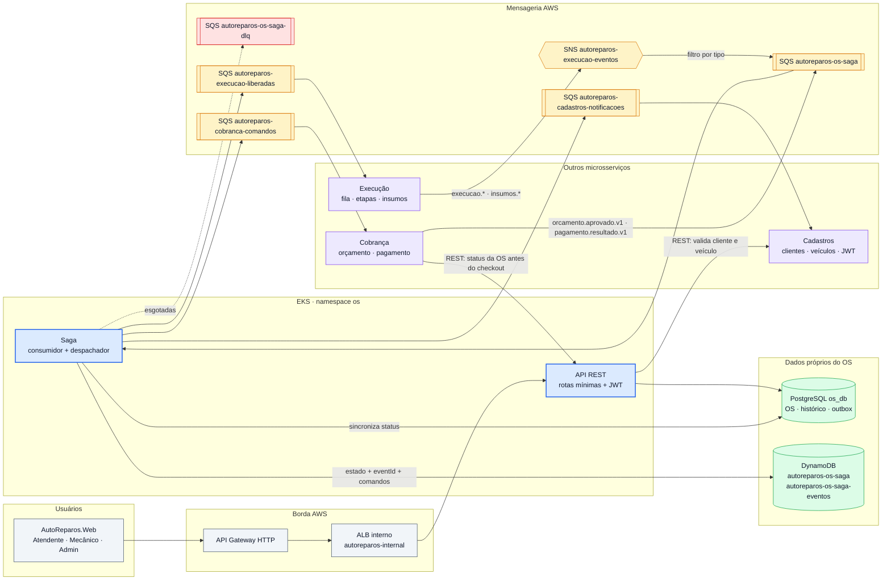
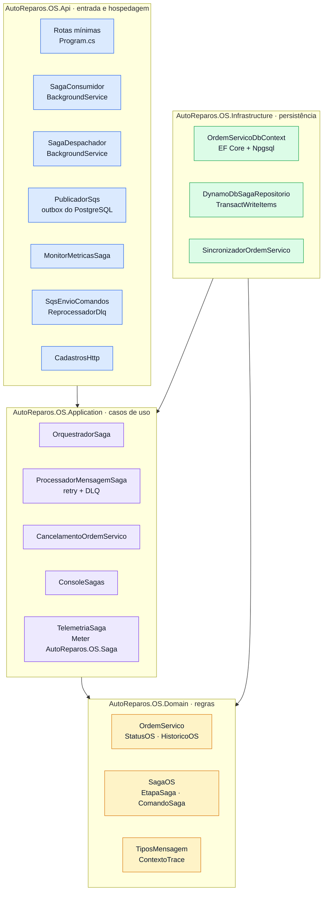
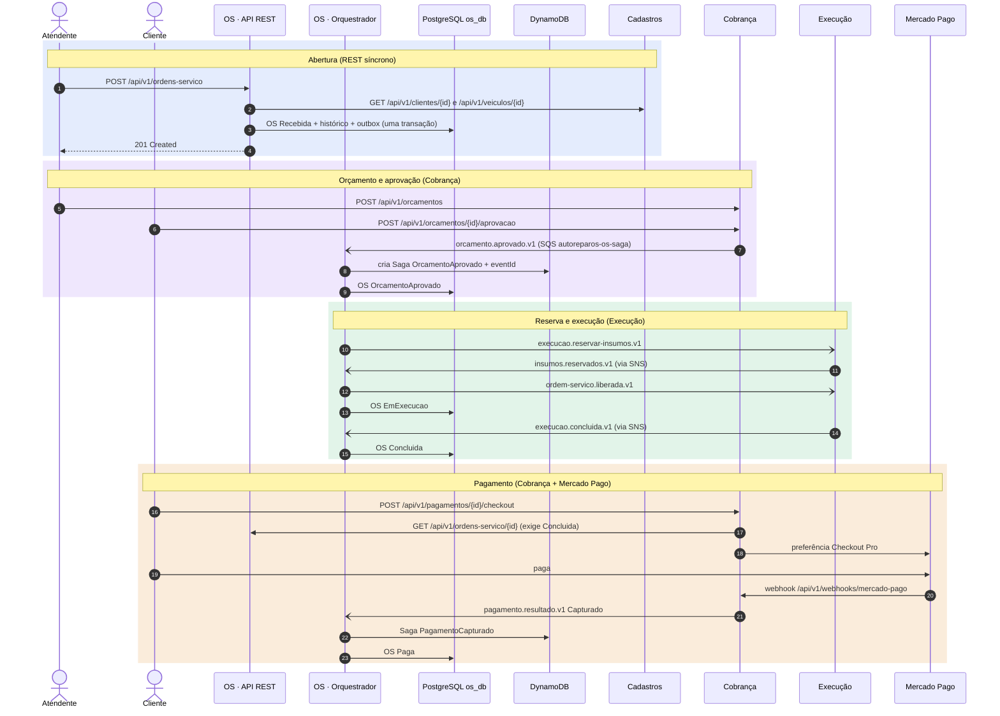
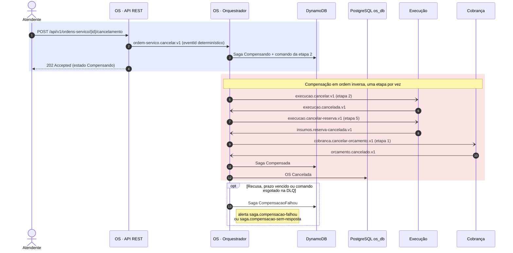
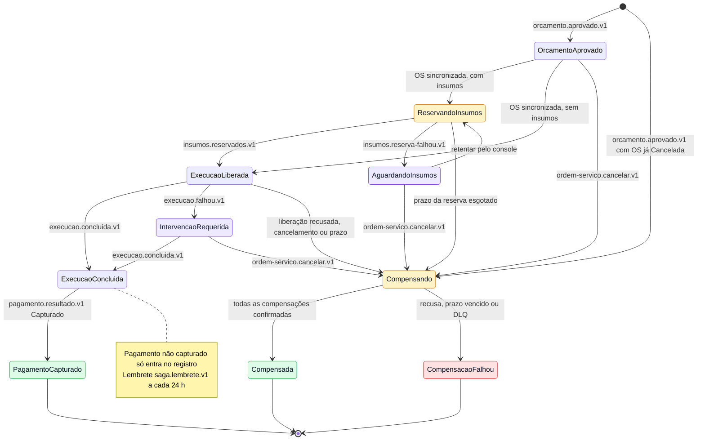
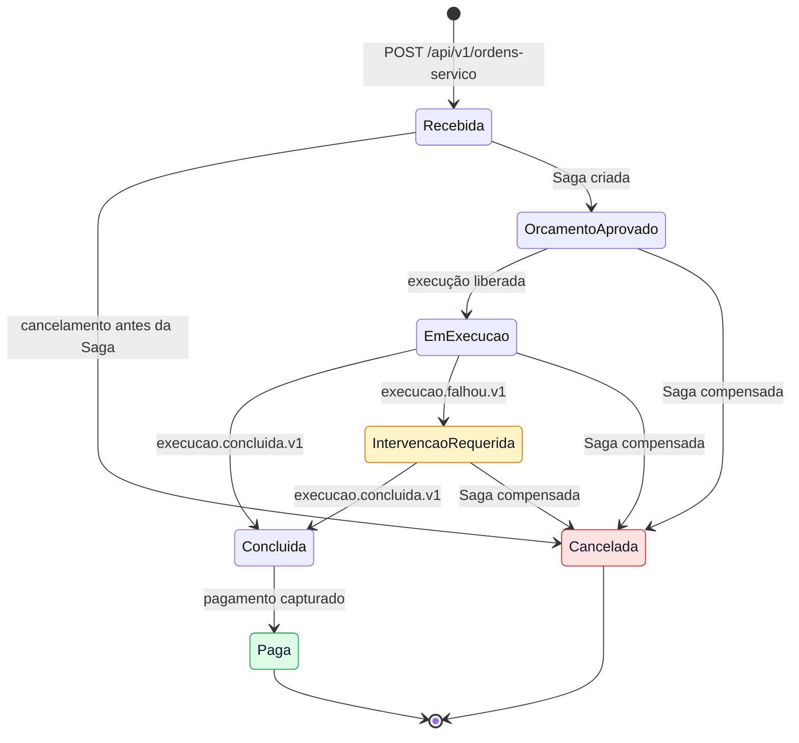
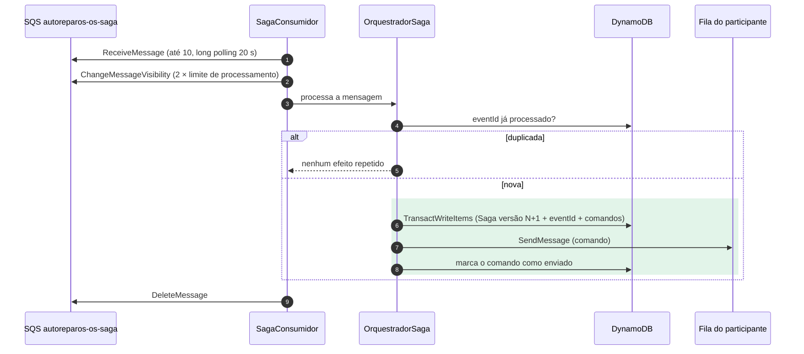
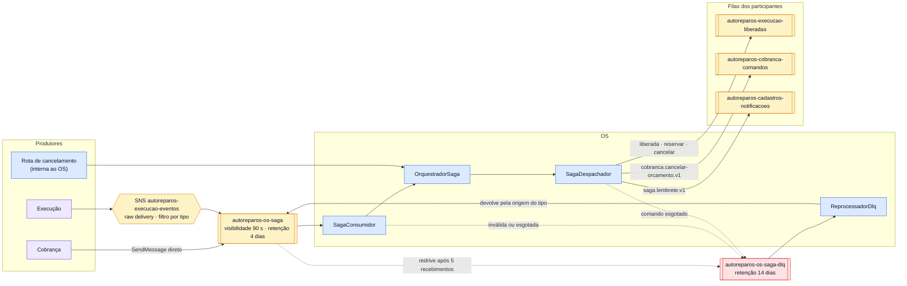
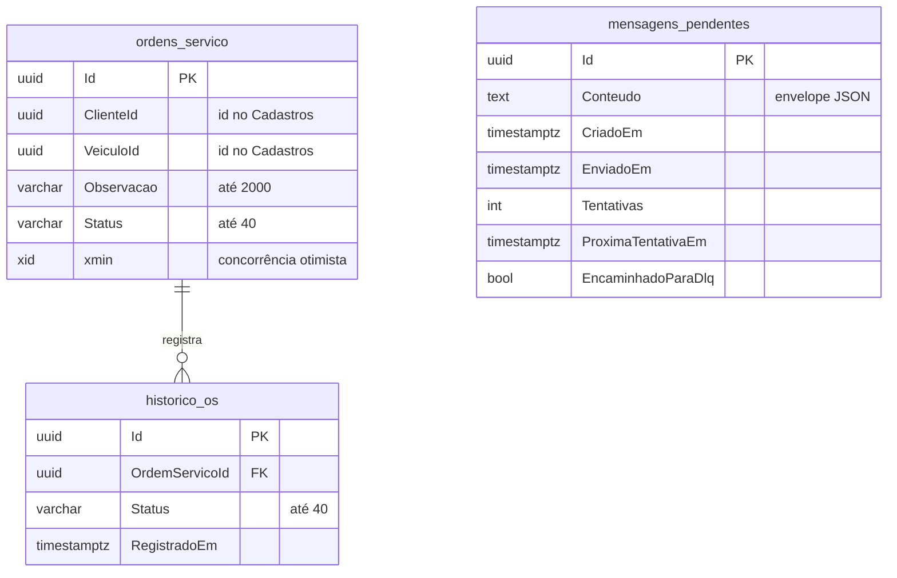
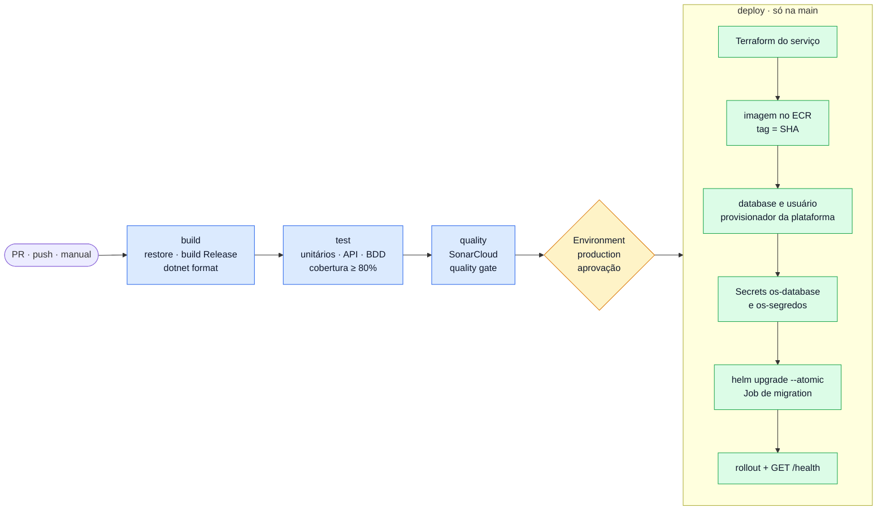

# AutoReparos.OS — Ordens de Serviço e Orquestrador da Saga

[](https://github.com/Grupo78-PosTech-15SOAT/AutoReparos.OS/actions/workflows/ci-cd.yml)
[](https://sonarcloud.io/project/overview?id=Grupo78-PosTech-15SOAT_AutoReparos.OS)
[](https://sonarcloud.io/component_measures?id=Grupo78-PosTech-15SOAT_AutoReparos.OS&metric=coverage)


> **Tech Challenge FIAP SOAT — Fase 4 (Grupo 78).** Microsserviço dono do ciclo de vida da ordem de serviço (OS) e **orquestrador da Saga** que coordena Cobrança e Execução por mensagens SQS, com estado persistido em **DynamoDB** e compensação em ordem inversa.

| Em números | |
| --- | --- |
| Rotas REST | 8 (mais `GET /health`) |
| Mensagens consumidas pela Saga | 13 tipos `*.v1` |
| Comandos publicados pela Saga | 6 tipos `*.v1` |
| Estados da Saga / status da OS | 10 / 7 |
| Testes no CI (último run da `main`) | 186 + 8 + **6 cenários BDD** |
| Cobertura de linhas no CI | **96,01%** (mínimo exigido: 80%) |

## Sumário

1. [Visão geral](#visão-geral)
2. [Arquitetura do serviço](#arquitetura-do-serviço)
3. [API REST](#api-rest)
4. [Saga](#saga)
5. [Mensageria](#mensageria)
6. [Bancos de dados](#bancos-de-dados)
7. [Observabilidade](#observabilidade)
8. [Como rodar localmente](#como-rodar-localmente)
9. [Testes e BDD](#testes-e-bdd)
10. [Cobertura e qualidade](#cobertura-e-qualidade)
11. [CI/CD e deploy](#cicd-e-deploy)
12. [Configuração](#configuração)
13. [Repositórios do projeto](#repositórios-do-projeto)

---

## Visão geral

O OS é um dos quatro microsserviços da Fase 4 (Cadastros, **OS**, Cobrança e Execução), cada um com repositório, banco, chart Helm, Terraform e pipeline próprios. Ele responde por duas coisas:

| Responsabilidade | Como |
| --- | --- |
| **Ciclo de vida da OS** | Abertura (validando cliente e veículo no Cadastros), consulta de status e histórico, observação e cancelamento |
| **Orquestração da Saga** | Consome as respostas de Cobrança e Execução, decide o próximo passo, persiste o estado no DynamoDB, publica comandos e compensações e sincroniza o status da OS no PostgreSQL |

O que o OS **não** faz: não gera orçamento nem cobra (Cobrança), não executa nem reserva insumos (Execução), não guarda clientes e veículos (Cadastros) e **não acessa o banco de nenhum outro serviço** — fala com eles só por REST ou por mensagens.

### Papel no ecossistema



Em produção (`us-east-1`, cluster EKS `AutoReparosEKS`) as rotas públicas do OS ficam atrás do API Gateway `https://8afyzjqfk2.execute-api.us-east-1.amazonaws.com`, que chega ao ALB interno por VPC Link.

---

## Arquitetura do serviço

Clean Architecture em quatro projetos (solução `AutoReparos.OS.slnx`, .NET 10). As dependências apontam para dentro: `Api → Application → Domain` e `Infrastructure → Application/Domain`.



| Projeto | Responsabilidade | Principais arquivos |
| --- | --- | --- |
| `AutoReparos.OS.Domain` | OS e histórico, estados e máquina da Saga, comandos e contrato de mensagens, contexto de trace W3C | `OrdemServico.cs`, `StatusOS.cs`, `SagaOS.cs`, `EstadoSaga.cs`, `EtapaSaga.cs`, `ComandoSaga.cs`, `TiposMensagem.cs` |
| `AutoReparos.OS.Application` | Orquestrador, leitura e validação das mensagens, retry/DLQ, despachador, cancelamento, console administrativo, métricas | `Saga/OrquestradorSaga.cs`, `Saga/MensagemSaga.cs`, `Saga/ProcessadorMensagemSaga.cs`, `Saga/DespachadorSaga.cs`, `Saga/OpcoesSaga.cs` |
| `AutoReparos.OS.Infrastructure` | PostgreSQL (EF Core), migrations, repositório da Saga no DynamoDB, criação de tabelas para ambiente local | `OrdemServicoDbContext.cs`, `Saga/DynamoDbSagaRepositorio.cs`, `Saga/DynamoDbInicializador.cs`, `Migrations/` |
| `AutoReparos.OS.Api` | Rotas mínimas, JWT e políticas por papel, serviços em segundo plano (consumidor, despachador, outbox, métricas), clientes SQS e Cadastros, OpenTelemetry, modo migrar-e-sair | `Program.cs`, `SagaConsumidor.cs`, `SagaDespachador.cs`, `PublicadorSqs.cs`, `CadastrosHttp.cs` |

```text
AutoReparos.OS/
├── AutoReparos.OS.Api/              # host ASP.NET Core: rotas, JWT, hosted services, OTel
├── AutoReparos.OS.Application/      # orquestrador e casos de uso da Saga
├── AutoReparos.OS.Domain/           # OrdemServico, SagaOS, estados, contrato de mensagens
├── AutoReparos.OS.Infrastructure/   # EF Core (PostgreSQL), DynamoDB, migrations
├── AutoReparos.OS.Tests/            # unitários e integração (Testcontainers)
├── AutoReparos.OS.Api.Tests/        # host: /health, migrar-e-sair, IRSA, autorização
├── AutoReparos.OS.BddTests/         # Reqnroll: 6 cenários da Saga em português
├── AutoReparos.OS.IntegrationTests/ # prova de isolamento de banco (fora do CI)
├── deploy/helm/os/                  # chart Helm do serviço
├── infra/terraform/                 # ECR, SQS, DynamoDB, IRSA, segredo da database, assinatura SNS
├── postman/                         # collection das rotas
├── scripts/                         # verificador da documentação da Saga
├── Dockerfile
└── .github/workflows/ci-cd.yml      # build → test → quality → deploy
```

### Decisões que moldam o serviço

| Decisão | O que foi decidido | Onde aparece no código |
| --- | --- | --- |
| D-07 | Saga **orquestrada e persistida**, com o OS como orquestrador | `OrquestradorSaga`, `SagaOS` |
| D-04 | NoSQL = **DynamoDB** para o estado da Saga | `DynamoDbSagaRepositorio`, `infra/terraform/dynamodb.tf` |
| L-01 (opção C) | Cada passo grava num único banco: a Saga no DynamoDB, a OS no PostgreSQL, ligados por comandos e sincronização — nenhum handler grava nos dois numa mesma transação | `SagaOS.SincronizacoesPendentes`, `SincronizadorOrdemServico` |
| D-06 / D-08 | SQS com DLQ, `AWSSDK.SQS` com Outbox, Inbox (deduplicação por `eventId`) e retry próprio, sem MassTransit | `ProcessadorMensagemSaga`, `SqsEnvioComandos` |
| D-21 / D-57 | JWT assimétrico emitido pelo Cadastros, validado por `Authority` e audiência `autoreparos` | `Program.cs`, `values.yaml` |
| D-33 | Cancelamento espera a confirmação da reserva de insumos (`409 saga_em_andamento`) | `SagaOS.AplicarCancelamento`, `CancelamentoOrdemServico` |
| D-65 / D-66 | Trace W3C no envelope das mensagens e métricas da Saga para o dashboard | `ContextoTrace`, `MensageriaTelemetria`, `TelemetriaSaga` |
| D-67 | Eventos da Execução chegam por SNS `autoreparos-execucao-eventos` com filtro por `tipo` | `infra/terraform/assinatura-execucao.tf` |
| D-42 / D-43 / D-47 | Terraform e chart no próprio repositório; migrations por Job Helm `pre-install,pre-upgrade` | `infra/terraform/`, `deploy/helm/os/` |

O registro completo de decisões está no [índice da especificação da Fase 4](https://github.com/Grupo78-PosTech-15SOAT/AutoReparos/blob/main/.specs/features/fase4/especificacao/index.md) do repositório principal.

---

## API REST

Todas as rotas de negócio exigem JWT emitido pelo Cadastros (`Authentication__Authority`, audiência `autoreparos`). As políticas são definidas em `Program.cs`:

| Política | Papéis aceitos |
| --- | --- |
| `OperarOS` | `Administrador`, `Atendente`, `Mecanico`, `ServicoOS` |
| `CancelarOS` | `Administrador`, `Atendente` |
| `AdministrarSagas` | `Administrador` |

| Verbo | Rota | Autorização | O que faz | Respostas |
| --- | --- | --- | --- | --- |
| `GET` | `/health` | anônima | Health check com verificação da database (probes do kubelet e do ALB) | `200`, `503` |
| `POST` | `/api/v1/ordens-servico` | `OperarOS` | Abre a OS (`clienteId`, `veiculoId`, `observacao` opcional) depois de validar cliente e veículo no Cadastros | `201`, `404`, `422`, `503` |
| `GET` | `/api/v1/ordens-servico/{id}` | `OperarOS` | Consulta status e histórico completo (ordenado por data) | `200`, `404` |
| `PATCH` | `/api/v1/ordens-servico/{id}` | `OperarOS` | Altera a observação (até 2000 caracteres) | `200`, `404`, `409`, `422` |
| `POST` | `/api/v1/ordens-servico/{id}/cancelamento` | `CancelarOS` | Gatilho de produção da compensação (`{ "motivo": "..." }`) | `202`, `404`, `409`, `422` |
| `GET` | `/api/v1/admin/sagas?estado=&paradaHaMinutos=` | `AdministrarSagas` | Lista Sagas por estado e por inatividade | `200`, `422` |
| `GET` | `/api/v1/admin/sagas/{ordemServicoId}` | `AdministrarSagas` | Estado, etapas, comandos, itens e registro (auditoria) da Saga | `200`, `404` |
| `POST` | `/api/v1/admin/sagas/{ordemServicoId}/retentar` | `AdministrarSagas` | Retenta a reserva de insumos de uma Saga em `AguardandoInsumos` (`{ "motivo": "..." }`) | `202`, `404`, `409`, `422` |
| `POST` | `/api/v1/admin/dlq/reprocessar` | `AdministrarSagas` | Devolve até `quantidade` (1 a 100) mensagens da DLQ da Saga à fila de origem | `202`, `422` |

**Exposição.** O Ingress do chart publica no ALB interno (e daí no API Gateway) os prefixos `/api/v1/ordens-servico` e `/api/v1/admin/sagas`. A rota `/api/v1/admin/dlq/reprocessar` não está entre os prefixos do Ingress: é usada de dentro do cluster (por exemplo, `kubectl port-forward`).

**Contrato e documentação.** A collection [`postman/AutoReparos.OS.postman_collection.json`](postman/AutoReparos.OS.postman_collection.json) cobre todas as rotas acima (variáveis `baseUrl`, `token`, `ordemServicoId`, `clienteId`, `veiculoId`); o arquivo [`AutoReparos.OS.Api/AutoReparos.OS.Api.http`](AutoReparos.OS.Api/AutoReparos.OS.Api.http) serve para chamadas rápidas na IDE. O documento OpenAPI (`/openapi/v1.json`) é publicado apenas no ambiente `Development`.

### Abertura da OS e o Cadastros

`POST /api/v1/ordens-servico` é a única chamada síncrona do OS para outro serviço: consulta `GET /api/v1/clientes/{id}` e `GET /api/v1/veiculos/{id}` no Cadastros (timeout de 5 s), repassando o JWT de quem abre a OS. Identidades com o papel `ServicoOS` não têm usuário humano no Cadastros e usam o cabeçalho `X-Chave-Interna`.

| Situação | Resposta |
| --- | --- |
| OS aberta (status `Recebida`, histórico e evento de outbox na mesma transação) | `201` com `id` e `status` |
| Cliente ou veículo inexistente | `404` com `codigo` `cliente_nao_encontrado` ou `veiculo_nao_encontrado` |
| Veículo de outro cliente | `422` `veiculo_de_outro_cliente` |
| Corpo inválido (ids vazios, observação acima de 2000 caracteres, JSON inválido) | `422` `ordem_servico_invalida` |
| Cadastros fora do ar ou recusando a chamada | `503` `cadastros_indisponivel` |

### Cancelamento

| Resposta | Quando |
| --- | --- |
| `202` com `ordemServicoId`, `correlacaoId` e `estado` | Cancelamento aceito, ou repetição de um já aceito (idempotente). OS sem Saga vira `Cancelada` na hora (`correlacaoId: null`); OS com Saga devolve o estado da Saga no instante, em geral `Compensando` |
| `404` | OS inexistente |
| `409` `saga_em_andamento` | A Saga está reservando insumos ou já compensando por outro pedido (D-33) |
| `409` `cancelamento_indisponivel` | A execução já concluiu ou o pagamento foi capturado — **nunca há estorno automático** |
| `422` `ordem_servico_invalida` | `motivo` ausente, vazio, acima de 2000 caracteres, com NUL, com surrogate isolado ou JSON inválido |

Com Saga, a rota gera a mensagem `ordem-servico.cancelar.v1` com `eventId` determinístico por OS (SHA-256 de tipo + id) e a aplica no orquestrador; a compensação segue de forma assíncrona.

---

## Saga

O OS Service é o **orquestrador** da Saga do ciclo da OS (decisão D-07). A estratégia é **orquestrada e persistida**: o orquestrador conhece o fluxo inteiro, decide cada passo, grava o estado no **DynamoDB** (tabela própria `autoreparos-os-saga`, um item por `ordemServicoId`) e só então publica comandos. Cobrança e Execução são participantes: recebem comandos nas próprias filas, respondem com eventos e nunca leem o estado da Saga.

A Saga nasce no primeiro `orcamento.aprovado.v1` da OS. Antes disso só existe a OS no PostgreSQL, o que evita gravar em dois bancos na abertura (regra L-01).

### Por que orquestração e não coreografia

Na coreografia, cada serviço reage aos eventos dos outros e ninguém conhece o fluxo inteiro. Na orquestração, um coordenador único — o OS, que já é dono do ciclo de vida da OS — conhece a sequência, decide o próximo passo e guarda o estado. O ciclo da AutoReparos tem passos sequenciais com dependências fortes (orçamento aprovado → reserva de insumos → liberação → execução → pagamento) e precisa desfazer etapas na ordem certa; por isso a justificativa da escolha se apoia em quatro critérios:

| Critério | Orquestração (escolhida) | Coreografia (descartada) |
| --- | --- | --- |
| **Visibilidade** | Um registro diz em que etapa cada OS está, quais comandos saíram e por quê (`GET /api/v1/admin/sagas/{id}` e dashboard `Saga`) | O estado fica espalhado em três bancos e só se reconstrói juntando logs de serviços diferentes |
| **Retomada** | Após uma queda, o despachador relê o estado persistido e continua do último passo, sem perder etapas concluídas | Não há quem retome um fluxo parado no meio: cada serviço só conhece o próprio pedaço |
| **Compensação ordenada** | Falhas e cancelamentos desfazem as etapas concluídas em ordem inversa (execução → reserva → orçamento), uma por vez, com confirmação de cada uma | A ordem emerge de reações em cadeia e é difícil de garantir quando as mensagens chegam fora de ordem |
| **Auditoria** | Cada transição, comando, rejeição e resultado de compensação fica no registro da Saga com o `correlacaoId` | A trilha precisa ser montada a partir de eventos soltos |

O motivo final é operacional: travas de estado, prazos técnicos, lembretes, console de administração e reprocessamento de DLQ (D-18) só são viáveis com um ponto que conhece o estado. O custo aceito é um coordenador central, mitigado por estado durável, escrita condicional por versão, deduplicação por `eventId` e retentativas; o orquestrador conhece apenas contratos de mensagens, nunca bancos ou código dos participantes.

### Etapas e compensações

| Etapa | Nome | Concluída quando | Compensação | Confirmação esperada |
| :---: | --- | --- | --- | --- |
| 1 | Orçamento aprovado | a Saga nasce (`orcamento.aprovado.v1`) | `cobranca.cancelar-orcamento.v1` | `orcamento.cancelado.v1` ou `orcamento.cancelamento-recusado.v1` |
| 5 | Insumos reservados | `insumos.reservados.v1` (só existe quando o orçamento tem insumos) | `execucao.cancelar-reserva.v1` | `insumos.reserva-cancelada.v1` |
| 2 | Execução liberada | o comando `ordem-servico.liberada.v1` é persistido | `execucao.cancelar.v1` | `execucao.cancelada.v1` ou `execucao.cancelamento-recusado.v1` |
| 3 | Execução concluída | `execucao.concluida.v1` | nenhuma — **pivô**: a partir daqui não há cancelamento | — |
| 4 | Pagamento capturado | `pagamento.resultado.v1` com `Capturado` | nenhuma — **nunca há estorno automático** (D-09) | — |

- **Ordem inversa:** a compensação sai sempre da etapa concluída de maior posição, na sequência **2 → 5 → 1**, e a próxima só é emitida depois que a anterior é confirmada.
- **Liberação ainda não entregue:** um `ordem-servico.liberada.v1` pendente (por exemplo, em backoff) é **descartado** no cancelamento em vez de compensado — a Execução nunca o recebeu.
- **Falha na execução:** `execucao.falhou.v1` leva a `IntervencaoRequerida`, sem compensar; a reexecução manual na Execução gera `execucao.concluida.v1`, ou o atendente cancela e as etapas 2, 5 e 1 são compensadas.
- **Falta de saldo (D-20):** `insumos.reserva-falhou.v1` leva a `AguardandoInsumos`, nada é reservado e o orçamento não é compensado; um administrador retenta pela rota de console ou o atendente cancela (compensa só a etapa 1).
- **Orçamento aprovado depois do cancelamento:** se a OS foi cancelada sem Saga e o `orcamento.aprovado.v1` chega depois, a Saga nasce já compensando a etapa 1 e a OS não é reativada (alerta `saga.orcamento-aprovado-apos-cancelamento`).

Itens da reserva (D-32): a Cobrança envia `itens` (`{insumoId, quantidade}`) no `orcamento.aprovado.v1`; o OS monta o `execucao.reservar-insumos.v1` com eles, sem consultar ninguém. Lista vazia (orçamento só de mão de obra) pula a reserva e libera a execução direto.

### Fluxo feliz



Esse fluxo foi validado em produção em 17/11/2026 com o webhook automático do Mercado Pago: pagamento aprovado → notificação `202` na Cobrança → Saga `PagamentoCapturado` → OS `Paga`.

### Compensação

Cancelamento pelo atendente com a reserva feita e a execução liberada (cenário 6 do BDD):



### Máquina de estados da Saga



| Estado | Significado | Terminal |
| --- | --- | :---: |
| `OrcamentoAprovado` | Saga criada; sincronizando a OS antes do próximo passo | não |
| `ReservandoInsumos` | `execucao.reservar-insumos.v1` enviado, aguardando resposta (trava `409 saga_em_andamento`) | não |
| `AguardandoInsumos` | Sem saldo: nada reservado; alerta diário e lembrete ao cliente, aguarda retentativa ou cancelamento | não |
| `ExecucaoLiberada` | `ordem-servico.liberada.v1` persistido e publicado | não |
| `IntervencaoRequerida` | A execução falhou; aguarda reexecução manual (sem compensação) | não |
| `ExecucaoConcluida` | Execução concluída; aguardando pagamento (lembrete a cada 24 h, sem expirar) | não |
| `PagamentoCapturado` | Pagamento capturado; fim feliz | sim |
| `Compensando` | Compensações em andamento, em ordem inversa | não |
| `Compensada` | Todas as compensações confirmadas; OS `Cancelada` | sim |
| `CompensacaoFalhou` | Compensação recusada, sem resposta no prazo ou esgotada; exige intervenção e gera alerta | sim |

### Status da OS

A OS no PostgreSQL acompanha a Saga por sincronização idempotente (o mesmo status não duplica o histórico) com concorrência otimista. `Concluida` é o status que a Cobrança exige em `GET /api/v1/ordens-servico/{id}` para abrir o checkout.



### Persistir antes de publicar

Cada mensagem passa por um único `TransactWriteItems` no DynamoDB, que grava o novo estado (escrita condicional por `versao`), o `eventId` processado (Inbox) e os comandos pendentes (Outbox). Só depois o comando é publicado; se o processo cair entre as duas coisas, o despachador retoma a partir do índice esparso de trabalho pendente.



### Prazos, reenvios e lembretes

| Situação | Prazo (configurável) | Ao vencer |
| --- | --- | --- |
| Reserva sem resposta (`ReservandoInsumos`) | `Saga__PrazoReserva` = 2 min | Reenvia com novo `eventId` até `Saga__MaxReenvios` = 3 vezes; esgotado, trata a reserva como possivelmente feita e compensa com o motivo `liberacao_sem_resposta` (alertas `saga.passo-reenviado` e `saga.passo-sem-resposta`) |
| Liberação não entregue (`ExecucaoLiberada`) | `Saga__PrazoLiberacao` = 2 min | Reenvia até 3 vezes; esgotado, abandona a liberação (etapa 2 não é compensada) e compensa reserva e orçamento |
| Compensação sem confirmação (`Compensando`) | `Saga__PrazoCompensacao` = 15 min, reiniciado a cada etapa | Reenvia até 3 vezes; esgotado, `CompensacaoFalhou` com alerta `saga.compensacao-sem-resposta` |
| Aguardando pagamento (`ExecucaoConcluida`) | 24 h | Publica `saga.lembrete.v1` (`aguardando-pagamento`) ao Cadastros; **nunca** expira nem cancela |
| Aguardando insumos (`AguardandoInsumos`) | 24 h | Alerta `saga.aguardando-insumos` e `saga.lembrete.v1` (`aguardando-insumos`) |

Os prazos são avaliados pelo despachador, que consulta o índice esparso `trabalho-pendente-index` a cada 1–2 s; o relógio é injetável (`TimeProvider`) nos testes.

### Garantias e tratamento de falhas

- **Pelo menos uma vez, efeito uma vez:** cada `eventId` processado fica em `autoreparos-os-saga-eventos` (TTL de 30 dias, acima da retenção das filas) na mesma transação da transição; duplicatas, inclusive concorrentes, não repetem o efeito.
- **Concorrência:** conflito de versão relê e reavalia (até 10 vezes); duas mensagens simultâneas da mesma Saga nunca avançam as duas.
- **Retry técnico:** 5 tentativas com backoff exponencial (base 1 s, teto 30 s) e jitter de até 50%; esgotadas, a mensagem ou o comando vai à DLQ `autoreparos-os-saga-dlq` com alerta. Mensagem malformada ou de `tipo` desconhecido vai direto à DLQ. Um comando de compensação esgotado leva a `CompensacaoFalhou`.
- **Ordem dos comandos:** os comandos de uma Saga saem em ordem de criação; nenhum ultrapassa outro em backoff. Os lembretes ao Cadastros seguem uma fila própria para que um Cadastros fora do ar nunca atrase uma compensação.
- **Ids das confirmações:** `correlacaoId`, `orcamentoId` e `execucaoId` informados precisam coincidir com os da Saga; divergência é rejeitada e alertada (`saga.mensagem-divergente`).
- **Mensagem fora de ordem:** transição inválida é rejeitada de forma idempotente e registrada; um `Capturado` antes da conclusão gera `saga.pagamento-capturado-fora-de-ordem` e **nenhum estorno**.
- **Pagamento capturado com OS fora do ar:** recuperação para frente — retenta a sincronização com backoff (teto de 5 min, sem desistir) e alerta `saga.sincronizacao-os-falhou` a cada falha.
- **Isolamento por Saga:** uma exceção ao progredir uma Saga gera `saga.despacho-falhou` e o ciclo segue com as demais.
- **Consumidor com tempo limitado:** cada mensagem tem `Saga__LimiteProcessamentoMensagem` (60 s); estourado, ela não é apagada e reaparece quando a visibilidade vence. A fila também tem redrive nativo para a DLQ após 5 recebimentos.

### Alertas

Os alertas são logs de erro estruturados com o campo `CodigoAlerta` (e `OrdemServicoId`/`EventId` quando há), exportados por OTLP ao Loki.

| Código | Quando |
| --- | --- |
| `saga.mensagem-invalida` | Mensagem malformada ou de tipo desconhecido (vai direto à DLQ) |
| `saga.mensagem-esgotada` / `saga.comando-esgotado` | Mensagem ou comando esgotou as 5 tentativas e foi à DLQ |
| `saga.dlq-indisponivel` | Nem a DLQ aceitou o comando; ele continua pendente |
| `saga.compensacao-falhou` / `saga.compensacao-sem-resposta` | Compensação recusada, esgotada ou sem confirmação no prazo |
| `saga.passo-reenviado` / `saga.passo-sem-resposta` | Prazo técnico da reserva ou da liberação |
| `saga.aguardando-insumos` | Sem saldo de insumos (na hora e depois a cada dia) |
| `saga.cancelamento-recusado` | Cancelamento depois da execução concluída ou do pagamento |
| `saga.mensagem-divergente` / `saga.pagamento-capturado-fora-de-ordem` | Ids divergentes ou captura fora de ordem |
| `saga.orcamento-aprovado-apos-cancelamento` | Orçamento aprovado depois do cancelamento da OS sem Saga |
| `saga.sincronizacao-os-falhou` / `saga.despacho-falhou` | Falha ao sincronizar a OS ou ao progredir uma Saga |
| `saga.dlq-reprocessada` | Reprocessamento da DLQ, com o autor |

A documentação desta seção é conferida por `python3 scripts/assert_saga_readme.py --name saga-rationale --strategy orchestrated --state-store DynamoDB` (teste do verificador: `python3 -m unittest discover -s scripts -p "test_*.py"`).

---

## Mensageria

### Envelope

JSON em camelCase com `eventId` (estável em reenvios), `tipo`, `correlacaoId`, `ordemServicoId`, `ocorreuEm` (UTC, ISO 8601), os campos do `tipo` e, opcionalmente, `traceparent`/`tracestate` (W3C, D-65). O contrato completo está em [`saga-mensageria/contracts.md`](https://github.com/Grupo78-PosTech-15SOAT/AutoReparos/blob/main/.specs/features/fase4/saga-mensageria/contracts.md) do repositório principal.

```json
{
  "eventId": "6f1c2a3e-0b7d-4c55-9a1e-2d8f4b6c7a90",
  "tipo": "execucao.reservar-insumos.v1",
  "correlacaoId": "0d2e4f60-8a9b-4c1d-9e2f-3a4b5c6d7e8f",
  "ordemServicoId": "b3d5f7a1-1c2e-4f60-8a9b-0c1d2e3f4a5b",
  "ocorreuEm": "2026-11-17T19:13:00Z",
  "itens": [{ "insumoId": "5e6f7a8b-9c0d-4e1f-a2b3-c4d5e6f7a8b9", "quantidade": 2 }],
  "traceparent": "00-4bf92f3577b34da6a3ce929d0e0e4736-00f067aa0ba902b7-01"
}
```

### Topologia



### Mensagens consumidas (fila `autoreparos-os-saga`)

| `tipo` | Origem | Chega por | Efeito na Saga |
| --- | --- | --- | --- |
| `orcamento.aprovado.v1` | Cobrança | SQS direto | Cria a Saga (`orcamentoId`, `clienteId` e `itens` obrigatórios) |
| `pagamento.resultado.v1` | Cobrança | SQS direto | `Capturado` → `PagamentoCapturado` e OS `Paga`; os demais status (`SemTentativa`, `Pendente`, `Rejeitado`, `Cancelado`, `Expirado`, `Reembolsado`) só entram no registro |
| `orcamento.cancelado.v1` / `orcamento.cancelamento-recusado.v1` | Cobrança | SQS direto | Confirma ou recusa a compensação da etapa 1 |
| `insumos.reservados.v1` | Execução | SNS → SQS | Conclui a etapa 5 e libera a execução |
| `insumos.reserva-falhou.v1` | Execução | SNS → SQS | `AguardandoInsumos` |
| `insumos.reserva-cancelada.v1` | Execução | SNS → SQS | Confirma a compensação da etapa 5 |
| `execucao.concluida.v1` | Execução | SNS → SQS | `ExecucaoConcluida` e OS `Concluida` |
| `execucao.falhou.v1` | Execução | SNS → SQS | `IntervencaoRequerida` |
| `execucao.liberacao-recusada.v1` | Execução | SNS → SQS | Inicia a compensação |
| `execucao.cancelada.v1` / `execucao.cancelamento-recusado.v1` | Execução | SNS → SQS | Confirma ou recusa a compensação da etapa 2 |
| `ordem-servico.cancelar.v1` | OS (rota de cancelamento) | chamada interna | Inicia a compensação; `motivo` obrigatório (1 a 2000 caracteres) |

### Comandos publicados

| `tipo` | Fila de destino | Variável | Campos extras |
| --- | --- | --- | --- |
| `execucao.reservar-insumos.v1` | `autoreparos-execucao-liberadas` | `Sqs__ExecucaoQueueUrl` | `itens` `{insumoId, quantidade}` |
| `ordem-servico.liberada.v1` | `autoreparos-execucao-liberadas` | `Sqs__ExecucaoQueueUrl` | `id`, `clienteId`, `veiculoId` |
| `execucao.cancelar.v1` | `autoreparos-execucao-liberadas` | `Sqs__ExecucaoQueueUrl` | `motivo` |
| `execucao.cancelar-reserva.v1` | `autoreparos-execucao-liberadas` | `Sqs__ExecucaoQueueUrl` | `motivo` |
| `cobranca.cancelar-orcamento.v1` | `autoreparos-cobranca-comandos` | `Sqs__BillingQueueUrl` | `orcamentoId`, `motivo` (etapas e comandos gravados com o alias legado `billing.orcamento.cancelar.v1` são normalizados antes do envio) |
| `saga.lembrete.v1` | `autoreparos-cadastros-notificacoes` | `Sqs__CadastrosQueueUrl` | `clienteId`, `motivo` (`aguardando-pagamento` ou `aguardando-insumos`) |

### Outbox e Inbox

| Mecanismo | Onde | Como |
| --- | --- | --- |
| **Outbox da Saga** | Lista `comandos` dentro do item da Saga no DynamoDB | Gravada no mesmo `TransactWriteItems` da transição; o despachador publica e marca `enviadoEm`, ou encaminha à DLQ |
| **Inbox da Saga** | Tabela `autoreparos-os-saga-eventos` | `eventId` gravado com condição `attribute_not_exists` na mesma transação; TTL `expiraEm` |
| **Outbox da OS** | Tabela `mensagens_pendentes` no PostgreSQL | `ordem-servico.criada.v1` / `ordem-servico.atualizada.v1` gravados com a OS; o `PublicadorSqs` lê com `FOR UPDATE SKIP LOCKED`, tenta 5 vezes com backoff e jitter e então usa a DLQ |

Os eventos `ordem-servico.criada.v1` e `ordem-servico.atualizada.v1` (chaves `eventId`, `tipo`, `id`, `clienteId`, `veiculoId`, `status`, `observacao`) não têm consumidor hoje (D-59): em produção `Sqs__QueueUrl` fica vazia, o publicador se desliga com um log e os eventos permanecem no outbox.

### Reprocessamento da DLQ

`POST /api/v1/admin/dlq/reprocessar` (`{"quantidade": 1 a 100}`) lê a DLQ da Saga e devolve cada mensagem à fila de origem escolhida pelo `tipo`: eventos de entrada voltam a `autoreparos-os-saga`; comandos voltam à fila da Execução, da Cobrança ou do Cadastros. A mensagem só sai da DLQ depois de reenviada; tipo desconhecido permanece. A ação gera o alerta `saga.dlq-reprocessada` com o autor.

---

## Bancos de dados

O OS usa os dois tipos de banco exigidos pela Fase 4, ambos exclusivos dele:

| Banco | Uso | Por quê |
| --- | --- | --- |
| **PostgreSQL** `os_db` (usuário `os_app`, na instância RDS compartilhada, D-05) | OS, histórico de status e outbox | Dados relacionais com histórico e concorrência otimista; consulta de status e histórico pelo id |
| **DynamoDB** `autoreparos-os-saga` e `autoreparos-os-saga-eventos` (D-04) | Estado da Saga e deduplicação | Acesso sempre por chave (`ordemServicoId`, `eventId`), escrita condicional por versão e transações de até dois itens, sem esquema rígido para o documento da Saga |

### PostgreSQL `os_db`



Migrations (EF Core, em `AutoReparos.OS.Infrastructure/Migrations`): `CriarOrdensServico`, `AdicionarOutbox`, `AdicionarRetentativasOutbox` e `ControleConcorrenciaOtimista` (usa a coluna de sistema `xmin`, sem DDL). Em produção elas rodam no Job Helm `os-migracao` (`Database__RunMigrations=true`: aplica e encerra sem abrir HTTP); o OS não migra na inicialização.

### DynamoDB

| Tabela | Chave | Atributos | Padrões de acesso |
| --- | --- | --- | --- |
| `autoreparos-os-saga` | `ordemServicoId` (HASH) | `correlacaoId`, `estado`, `versao`, `atualizadoEm`, `documento` (JSON da Saga com etapas, comandos e registro), `trabalhoPendente`, `proximaTentativaEm` | `GetItem` consistente por OS; `Put` condicional (`attribute_not_exists` na criação, `versao = :esperada` depois); `Scan` filtrado só no console |
| índice `trabalho-pendente-index` | `trabalhoPendente` (HASH) + `proximaTentativaEm` (RANGE), `KEYS_ONLY` | **esparso**: só Sagas com trabalho pendente têm os atributos | `Query` do despachador: Sagas com algo devido até agora |
| `autoreparos-os-saga-eventos` | `eventId` (HASH) | `tipo`, `ordemServicoId`, `processadoEm`, `expiraEm` (TTL de 30 dias) | Verificação e registro de mensagem processada (Inbox) |

As tabelas são `PAY_PER_REQUEST`, criadas pelo Terraform do serviço (`infra/terraform/dynamodb.tf`). Em ambiente local e de teste, `DynamoDb__CriarTabelas=true` cria o mesmo esquema no DynamoDB Local.

### Isolamento

Nenhum outro serviço lê `os_db` ou as tabelas da Saga: a Cobrança consulta a OS pela API, e a IAM do OS (IRSA `autoreparos-os-irsa`) só alcança as próprias filas e tabelas. A prova `ServiceDatabaseIsolation` (`AutoReparos.OS.IntegrationTests`) confere os privilégios efetivos de papéis de outros serviços no banco do OS e o acesso por token; o script [`provisionar-papeis-servicos.sql`](AutoReparos.OS.IntegrationTests/provisionar-papeis-servicos.sql) cria esses papéis sem privilégios (senhas por variáveis do `psql`, nunca versionadas). A prova depende de um ambiente provisionado (variáveis `OS_PROOF_*`) e não roda no CI.

---

## Observabilidade

O serviço usa a mesma stack da Fase 3 (OpenTelemetry Collector, Prometheus, Grafana, Loki e Jaeger, no namespace `autoreparos`). Traces, métricas e logs saem por OTLP para `Telemetry__OtlpEndpoint` com `service.name` `autoreparos-os`.

| Sinal | Instrumentação |
| --- | --- |
| Traces | ASP.NET Core, HttpClient e `ActivitySource("AutoReparos.OS.Mensageria")`: span `Producer` "publicar {tipo}" e `Consumer` "processar {tipo}", com `messaging.system`, `messaging.message.id` e `ordem_servico.id`. O `traceparent` gravado no envelope liga o trace entre OS, Cobrança e Execução (D-65) |
| Métricas | `Meter("AutoReparos.OS.Saga")` + ASP.NET Core, HttpClient e runtime .NET |
| Logs | OTLP com escopos e valores estruturados; alertas com `CodigoAlerta` |

| Métrica (`Meter AutoReparos.OS.Saga`) | Tipo | Significado |
| --- | --- | --- |
| `sagas_iniciadas_total` | contador | Sagas criadas pelo orçamento aprovado |
| `sagas_concluidas_total` | contador | Sagas que chegaram a `PagamentoCapturado` |
| `sagas_compensadas_total{passo}` | contador | Comandos de compensação despachados, por tipo |
| `sagas_paradas` | gauge | Sagas não terminais sem atualização há `Saga__LimiarParada` (30 min) |
| `saga_dlq_mensagens` | gauge | Mensagens na DLQ da Saga (`ApproximateNumberOfMessages`, a cada 30 s) |

No Prometheus as métricas aparecem com o prefixo `autoreparos_` e alimentam o dashboard **Saga** do Grafana (painéis: Sagas iniciadas, Sagas concluídas, Sagas paradas, DLQ da Saga, Compensações por passo e atalho para os traces no Jaeger pela tag `ordem_servico.id`).

---

## Como rodar localmente

Pré-requisitos: **.NET SDK 10** e **Docker** (os testes sobem PostgreSQL 16 e DynamoDB Local com Testcontainers).

```bash
dotnet restore AutoReparos.OS.slnx
dotnet build AutoReparos.OS.slnx -m:1
dotnet format AutoReparos.OS.slnx --verify-no-changes --no-restore

dotnet test AutoReparos.OS.Tests        # unitários e integração da Saga
dotnet test AutoReparos.OS.Api.Tests    # host da API
dotnet test AutoReparos.OS.BddTests     # 6 cenários BDD
```

A forma mais completa de exercitar a Saga sem AWS são as suítes acima: elas usam o orquestrador real, PostgreSQL e DynamoDB Local reais e um SQS falso.

Para subir a API apontando para recursos locais:

```bash
docker run -d --name os-postgres -p 5432:5432 \
  -e POSTGRES_DB=os_db -e POSTGRES_USER=os_app -e POSTGRES_PASSWORD='<senha-local>' postgres:16-alpine

export ConnectionStrings__OrdemServico='Host=localhost;Port=5432;Database=os_db;Username=os_app;Password=<senha-local>'
export Authentication__Authority='<URL do emissor OIDC (Cadastros)>'
export Authentication__Audience='autoreparos'
export Authentication__RequireHttpsMetadata=false
export Cadastros__BaseUrl='<URL do Cadastros>'
export Cadastros__ChaveInterna='<chave interna>'
export AWS_REGION=us-east-1

Database__RunMigrations=true dotnet run --project AutoReparos.OS.Api   # aplica as migrations e sai
dotnet run --project AutoReparos.OS.Api                                  # http://localhost:5083
```

Sem `Sqs__SagaQueueUrl` a API atende as rotas de OS, mas o consumidor, o despachador e o monitor de métricas da Saga não iniciam (log de aviso). Para ligar a Saga, configure as filas SQS e o DynamoDB (`DynamoDb__ServiceUrl=http://localhost:8000` e `DynamoDb__CriarTabelas=true` com a imagem `amazon/dynamodb-local`); as credenciais AWS vêm da cadeia padrão do SDK, nunca do repositório.

Também é possível gerar a imagem: `docker build -t autoreparos-os .` (porta 8080, usuário sem privilégios).

---

## Testes e BDD

| Projeto | Tipo | Testes no CI | O que cobre |
| --- | --- | :---: | --- |
| `AutoReparos.OS.Tests` | xUnit, unitários e integração (Testcontainers: PostgreSQL 16 e DynamoDB Local; SQS falso) | 186 | Abertura com Cadastros, contratos da OS, outbox, fluxo e persistência da Saga, concorrência, retry/DLQ, insumos, prazos, lembretes, console, cancelamento, contrato entre serviços, métricas e trace |
| `AutoReparos.OS.Api.Tests` | xUnit, host da API | 8 | `/health`, modo migrar-e-sair, credenciais IRSA e contratos de autorização |
| `AutoReparos.OS.BddTests` | Reqnroll + xUnit, cenários em português | **6** | Fluxo completo da OS e compensações da Saga |
| `AutoReparos.OS.IntegrationTests` | prova em ambiente provisionado | — | Isolamento do banco do OS (fora do CI) |

### BDD (Reqnroll)

O fluxo completo exigido pela Fase 4 é testado em BDD no próprio OS (D-63, D-73): os cenários rodam a Saga real — orquestrador, PostgreSQL e DynamoDB Local em Testcontainers — com Cobrança e Execução simuladas pelas mensagens que enviariam, reaproveitando o `SagaHarness` de `AutoReparos.OS.Tests`. Rodam no job `test` do CI.

| # | Feature | Cenário |
| :---: | --- | --- |
| 1 | `FluxoCompletoDaOS.feature` | Pagamento aprovado conclui a Saga e marca a OS como paga |
| 2 | `FluxoCompletoDaOS.feature` | OS só de mão de obra pula a reserva e libera a execução direto |
| 3 | `CompensacoesDaSaga.feature` | Pagamento recusado não dispara compensação e deixa a Saga aguardando |
| 4 | `CompensacoesDaSaga.feature` | Falha na reserva de insumos aguarda saldo e o cancelamento compensa só o orçamento |
| 5 | `CompensacoesDaSaga.feature` | Liberação recusada pelo Execução compensa a reserva e o orçamento em ordem inversa |
| 6 | `CompensacoesDaSaga.feature` | Cancelamento pelo atendente com insumos reservados compensa em ordem inversa |

```gherkin
# language: pt
Cenário: Cancelamento pelo atendente com insumos reservados compensa em ordem inversa
  Dado uma ordem de serviço com orçamento aprovado e insumos a reservar
  E o Execução confirma a reserva dos insumos
  Então a Saga está no estado "ExecucaoLiberada"
  Quando o atendente cancela a ordem de serviço
  Então a Saga está no estado "Compensando"
  E a Saga enviou, nesta ordem, os comandos de compensação "execucao.cancelar.v1"
  Quando o Execução confirma o cancelamento da execução
  Então a Saga enviou, nesta ordem, os comandos de compensação "execucao.cancelar.v1, execucao.cancelar-reserva.v1"
  Quando o Execução confirma o cancelamento da reserva dos insumos
  Então a Saga enviou, nesta ordem, os comandos de compensação "execucao.cancelar.v1, execucao.cancelar-reserva.v1, cobranca.cancelar-orcamento.v1"
  Quando a Cobrança confirma o cancelamento do orçamento
  Então a Saga está no estado "Compensada"
  E a ordem de serviço está com o status "Cancelada"
```

---

## Cobertura e qualidade

O limite mínimo é de **80% de cobertura de linhas** por serviço, verificado no CI.

| Evidência | Valor |
| --- | --- |
| Último run da `main` ([#44099310357](https://github.com/Grupo78-PosTech-15SOAT/AutoReparos.OS/actions/runs/44099310357), commit `dbcec35`, 17/11/2026) | **96,01%** de linhas (1514 de 1577) — `build`, `test`, `quality` e `deploy` verdes |
| Testes do mesmo run | 186 (`AutoReparos.OS.Tests`) + 8 (`AutoReparos.OS.Api.Tests`) + 6 cenários BDD, todos aprovados |
| SonarCloud (quality gate e cobertura atuais) | https://sonarcloud.io/project/overview?id=Grupo78-PosTech-15SOAT_AutoReparos.OS |

Como funciona:

- O job `test` coleta a cobertura com coverlet (`XPlat Code Coverage`, formatos Cobertura e OpenCover, excluindo `Migrations` e `obj`) de `AutoReparos.OS.Tests` e `AutoReparos.OS.Api.Tests`.
- `.github/scripts/verificar_cobertura.py TestResults --minimo 80` une os relatórios (uma linha conta como coberta se algum relatório a cobrir) e **reprova o pipeline abaixo de 80%** (`MINIMO_COBERTURA`).
- O job `quality` envia os relatórios OpenCover e os resultados `.trx` ao SonarCloud (projeto `Grupo78-PosTech-15SOAT_AutoReparos.OS`, organização `grupo78-postech-15soat`) e espera o quality gate (`sonar.qualitygate.wait=true`); `bin`, `obj` e `Migrations` ficam fora da análise.

Para medir localmente: `dotnet test AutoReparos.OS.Tests --collect:"XPlat Code Coverage"` (Docker necessário).

---

## CI/CD e deploy

O pipeline [`.github/workflows/ci-cd.yml`](.github/workflows/ci-cd.yml) é independente dos demais serviços e roda em pull request e push para `main` e `develop` e por `workflow_dispatch`.



| Job | Quando | O que faz |
| --- | --- | --- |
| `build` | sempre | `dotnet restore`, `dotnet build -c Release` e `dotnet format --verify-no-changes` |
| `test` | depois do `build` | Testes de `AutoReparos.OS.Tests`, `AutoReparos.OS.Api.Tests` e `AutoReparos.OS.BddTests`, cobertura mínima de 80% e artefato `resultados-testes` |
| `quality` | push na `main` ou PR para a `main` | SonarCloud com quality gate; falha de propósito sem `SONAR_TOKEN` |
| `deploy` | push ou disparo manual na `main`, após os três anteriores | Environment `production` (aprovação obrigatória de revisor e deploy só pela `main`): Terraform, imagem no ECR, database pelo provisionador `autoreparos-provisionador-db` (chamada assinada SigV4), Secrets, `helm upgrade --install --atomic` e verificação de rollout e `GET /health` |

Os jobs `build` e `test` (e o `quality`) são os checks previstos para a proteção da `main` (D-25).

### Infraestrutura do serviço

| Onde | Recursos |
| --- | --- |
| `infra/terraform/` | ECR `autoreparos-os` (scan no push, guarda as 10 imagens mais recentes); filas `autoreparos-os-saga` e `autoreparos-os-saga-dlq` (SSE gerenciada); tabelas DynamoDB da Saga; role IRSA `autoreparos-os-irsa` com permissions boundary; segredo `autoreparos/production/os/database` no Secrets Manager; assinatura SNS do tópico da Execução com filtro por `tipo`. Lê a plataforma (EKS, OIDC, RDS) pelo SSM `/autoreparos/production/*` (D-53). Testes em `infra/terraform/tests/*.tftest.hcl` |
| `deploy/helm/os/` | `Deployment` (1 réplica, `securityContext` sem root, probes em `/health`), `Service` ClusterIP 8080, `HorizontalPodAutoscaler` (1 a 3 réplicas, CPU 80%), `Ingress` no ALB interno compartilhado, `ServiceAccount` com IRSA e `Job` de migration (`pre-install,pre-upgrade`) |
| `Dockerfile` | Build multi-stage (`dotnet/sdk:10.0` → `dotnet/aspnet:10.0`), porta 8080, usuário sem privilégios |

### Segredos e variáveis do repositório (só nomes)

| Nome | Tipo | Uso |
| --- | --- | --- |
| `SONAR_TOKEN` | secret | Análise no SonarCloud (obrigatório para o `quality`) |
| `SONAR_ORGANIZATION` / `SONAR_PROJECT_KEY` | variables (opcionais) | Padrões `grupo78-postech-15soat` e `Grupo78-PosTech-15SOAT_AutoReparos.OS` |
| `AWS_ROLE_ARN` | variable do Environment `production` | Role OIDC assumida pelo `deploy` |
| `TF_STATE_BUCKET` / `TF_LOCK_TABLE` | variables do Environment `production` | Backend do Terraform |
| `CHAVE_INTERNA` | secret do Environment `production` | Vira o Secret `os-segredos` (`Cadastros__ChaveInterna`) |

A connection string nunca passa pelo GitHub: o job a lê do Secrets Manager e grava o Secret `os-database` no namespace `os`.

---

## Configuração

Todas as configurações vêm de variáveis de ambiente (ou de Secrets do Kubernetes); nenhum valor sensível é versionado.

| Variável | Uso | Padrão / produção |
| --- | --- | --- |
| `ConnectionStrings__OrdemServico` | Conexão com `os_db` | Secret `os-database` |
| `Authentication__Authority` | Emissor do JWT (Cadastros, via API Gateway) | URL do gateway |
| `Authentication__Audience` | Audiência exigida | `autoreparos` |
| `Authentication__RequireHttpsMetadata` | Exige HTTPS no discovery OIDC | `true` |
| `Cadastros__BaseUrl` | URL interna do Cadastros | `http://cadastros.cadastros.svc.cluster.local:8080` |
| `Cadastros__ChaveInterna` | Valor de `X-Chave-Interna` para identidades de serviço | Secret `os-segredos` |
| `AWS_REGION` | Região AWS | `us-east-1` |
| `Sqs__SagaQueueUrl` | Fila de entrada da Saga (sem ela a Saga não inicia) | `autoreparos-os-saga` |
| `Sqs__SagaDeadLetterQueueUrl` | DLQ da Saga | `autoreparos-os-saga-dlq` |
| `Sqs__ExecucaoQueueUrl` | Comandos para a Execução | `autoreparos-execucao-liberadas` |
| `Sqs__BillingQueueUrl` | Comandos para a Cobrança | `autoreparos-cobranca-comandos` |
| `Sqs__CadastrosQueueUrl` | Lembretes para o Cadastros | `autoreparos-cadastros-notificacoes` |
| `Sqs__QueueUrl` / `Sqs__DeadLetterQueueUrl` | Publicação do outbox da OS | vazias em produção (D-59) |
| `DynamoDb__TabelaSaga` / `DynamoDb__TabelaEventos` | Nomes das tabelas | `autoreparos-os-saga` / `autoreparos-os-saga-eventos` |
| `DynamoDb__ServiceUrl` | Endpoint do DynamoDB Local | só local e testes |
| `DynamoDb__CriarTabelas` | Cria tabelas e índice se não existirem | `false` em produção |
| `Saga__PrazoReserva` / `Saga__PrazoLiberacao` | Prazo técnico da reserva e da entrega da liberação | `00:02:00` |
| `Saga__PrazoCompensacao` | Prazo da confirmação de cada compensação | `00:15:00` |
| `Saga__MaxReenvios` | Reenvios de um passo sem resposta | `3` |
| `Saga__LimiarParada` | Inatividade que conta como Saga parada | `00:30:00` |
| `Saga__LimiteProcessamentoMensagem` | Tempo máximo por mensagem | `00:01:00` |
| `Telemetry__ServiceName` / `Telemetry__OtlpEndpoint` | Nome do serviço e coletor OTLP | `autoreparos-os` / coletor do namespace `autoreparos` |
| `Database__RunMigrations` | Aplica as migrations e encerra (Job Helm) | `true` só no Job |

---

## Repositórios do projeto

| Repositório | Papel |
| --- | --- |
| [AutoReparos](https://github.com/Grupo78-PosTech-15SOAT/AutoReparos) | Repositório principal: plataforma (rede, EKS, RDS, API Gateway), especificação e documentação de entrega |
| [AutoReparos.OS](https://github.com/Grupo78-PosTech-15SOAT/AutoReparos.OS) | **Este serviço**: ordens de serviço e orquestrador da Saga |
| [AutoReparos.Cobranca](https://github.com/Grupo78-PosTech-15SOAT/AutoReparos.Cobranca) | Orçamento, aprovação, Mercado Pago e reembolso |
| [AutoReparos.Execucao](https://github.com/Grupo78-PosTech-15SOAT/AutoReparos.Execucao) | Fila de execução, etapas, catálogo e reserva de insumos |
| [AutoReparos.Cadastros](https://github.com/Grupo78-PosTech-15SOAT/AutoReparos.Cadastros) | Clientes, veículos, usuários e emissão do JWT |
| [AutoReparos.Web](https://github.com/Grupo78-PosTech-15SOAT/AutoReparos.Web) | Frontend Angular |
| [AutoReparos.AuthLambda](https://github.com/Grupo78-PosTech-15SOAT/AutoReparos.AuthLambda) | Autenticação do cliente por CPF |
| [AutoReparos.Infra.K8s](https://github.com/Grupo78-PosTech-15SOAT/AutoReparos.Infra.K8s) | Chart de observabilidade e do Web |
| [AutoReparos.Infra.Database](https://github.com/Grupo78-PosTech-15SOAT/AutoReparos.Infra.Database) | Infraestrutura de banco da plataforma |

Leituras complementares no repositório principal: [especificação da Saga](https://github.com/Grupo78-PosTech-15SOAT/AutoReparos/blob/main/.specs/features/fase4/especificacao/saga/fase4_spec_saga_pattern.md), [arquitetura final e justificativa](https://github.com/Grupo78-PosTech-15SOAT/AutoReparos/blob/main/docs/entrega/fase4/arquitetura_e_justificativa.md) e [contrato de mensagens da Saga](https://github.com/Grupo78-PosTech-15SOAT/AutoReparos/blob/main/.specs/features/fase4/saga-mensageria/contracts.md).
