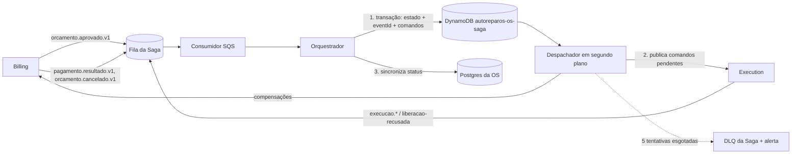

# AutoReparos.OS

Serviço de ordens de serviço da Fase 4. Configure `ConnectionStrings__OrdemServico` com a conexão do banco próprio, `Authentication__Authority` e `Authentication__Audience` com os dados do emissor JWT, `AWS_REGION`, `Sqs__QueueUrl` e `Sqs__DeadLetterQueueUrl` antes de executar.

O serviço exige os papéis `Administrador`, `Atendente`, `Mecanico` ou `ServicoOS`; a rota de cancelamento exige `Administrador` ou `Atendente`. O emissor deve atribuir `ServicoOS` somente às identidades de serviço autorizadas.

Aplique as migrações com `dotnet ef database update --project AutoReparos.OS.Infrastructure --startup-project AutoReparos.OS.Api` usando as credenciais de migração apropriadas. Configure a conexão por variável de ambiente; não armazene credenciais no repositório.

Os eventos são gravados na mesma transação da OS. O publicador tenta a fila principal cinco vezes, com intervalo exponencial e jitter, e encaminha o evento à DLQ. Uma falha no envio à DLQ mantém o evento pendente e registra erro para intervenção. A entrega é pelo menos uma vez: os consumidores devem deduplicar pelo `eventId`. Configure alertas para os erros de publicação e a DLQ no ambiente de observabilidade.

## Contrato do evento

O payload JSON publicado no outbox e na fila SQS usa camelCase em todas as chaves: `eventId`, `tipo`, `id`, `clienteId`, `veiculoId`, `status` e `observacao` (`observacao` pode ser `null`). O `tipo` é `ordem-servico.criada.v1` ou `ordem-servico.atualizada.v1`.

```json
{
  "eventId": "6f1c2a3e-0b7d-4c55-9a1e-2d8f4b6c7a90",
  "tipo": "ordem-servico.criada.v1",
  "id": "b3d5f7a1-1c2e-4f60-8a9b-0c1d2e3f4a5b",
  "clienteId": "0a1b2c3d-4e5f-4a6b-8c7d-9e0f1a2b3c4d",
  "veiculoId": "5e6f7a8b-9c0d-4e1f-a2b3-c4d5e6f7a8b9",
  "status": "Recebida",
  "observacao": "troca de óleo"
}
```

## Prova de isolamento

O teste `ServiceDatabaseIsolation` consulta os privilégios efetivos dos papéis de Billing e Execução e acessa uma OS com o token de cada serviço. Para executá-lo em um ambiente de teste provisionado, configure `OS_PROOF_DB_CONNECTION`, `OS_PROOF_API_URL`, `OS_PROOF_ORDER_ID`, `OS_PROOF_BILLING_DB_ROLE`, `OS_PROOF_EXECUTION_DB_ROLE`, `OS_PROOF_BILLING_TOKEN` e `OS_PROOF_EXECUTION_TOKEN` no ambiente do processo. A conexão de prova deve poder consultar os privilégios dos papéis. Use uma OS de teste e identidades representativas do ambiente; não registre os tokens ou a conexão em arquivos versionados.

O script versionado `AutoReparos.OS.IntegrationTests/provisionar-papeis-servicos.sql` cria os papéis `autoreparos_billing` e `autoreparos_execucao` sem privilégios nas tabelas do OS (as senhas são passadas por variáveis do `psql`, nunca versionadas):

```
psql -v ON_ERROR_STOP=1 -v billing_password=<senha> -v execucao_password=<senha> -f AutoReparos.OS.IntegrationTests/provisionar-papeis-servicos.sql
```

Depois de aplicar as migrações e o script, publique a API apontando para esse banco, crie uma OS de teste, obtenha tokens de serviço com o papel `ServicoOS` e configure `OS_PROOF_BILLING_DB_ROLE=autoreparos_billing` e `OS_PROOF_EXECUTION_DB_ROLE=autoreparos_execucao` junto com as demais variáveis acima. Em seguida execute `dotnet test AutoReparos.OS.IntegrationTests --filter FullyQualifiedName~ServiceDatabaseIsolation`. A prova cobre o isolamento de leitura e o acesso por API; o consumo por eventos depende dos consumidores de cada serviço e não é exercitado aqui.

## Saga

O OS Service é o **orquestrador** da Saga do ciclo da OS. A estratégia é **orquestrada**: o OS Service decide cada passo, persiste o estado e envia comandos; Billing e Execution apenas respondem por mensagens SQS e nunca leem o estado da Saga. O estado fica em **DynamoDB**, em tabela própria do OS (`autoreparos-os-saga`), com um item por `ordemServicoId`. A Saga nasce no primeiro `orcamento.aprovado.v1` da OS, o que evita escrita dupla (Postgres e DynamoDB) na criação da OS.

### Por que orquestração e não coreografia

Na coreografia cada serviço reage aos eventos dos outros e ninguém conhece o fluxo inteiro; na orquestração um único coordenador (o OS Service) conhece o fluxo, decide o próximo passo e guarda o estado. Para este ciclo, que envolve OS, Billing e Execution e exige desfazer etapas, a comparação nos quatro critérios que a Fase 4 exige é esta:

- **Visibilidade**: na orquestração o estado central diz em que etapa cada OS está e por quê; na coreografia o estado fica espalhado em três bancos e só se reconstrói juntando logs de serviços diferentes.
- **Retomada**: na orquestração, após uma queda, o orquestrador relê o estado persistido e continua do último passo, sem perder etapas concluídas; na coreografia não há quem retome um fluxo parado no meio, porque cada serviço só conhece o seu pedaço.
- **Compensação ordenada**: na orquestração falhas e cancelamentos desfazem as etapas concluídas em ordem inversa (execução, depois orçamento), uma por vez, com confirmação de cada uma; na coreografia a ordem emerge de reações em cadeia e é difícil de garantir.
- **Auditoria**: na orquestração cada transição, comando e resultado de compensação fica registrado na Saga, com o `correlacaoId` da OS; na coreografia a trilha precisa ser montada a partir de eventos soltos.

O custo aceito é um ponto central de coordenação, mitigado por estado durável, deduplicação e retentativas.

### Diagrama



Sequência normal: `orcamento.aprovado.v1` cria a Saga em `OrcamentoAprovado` → a OS é sincronizada → a Saga avança para `ExecucaoLiberada` e o comando `ordem-servico.liberada.v1` é publicado → `execucao.concluida.v1` → `pagamento.resultado.v1` com `Capturado`. Toda transição grava o estado novo, o `correlacaoId`, o registro do `eventId` processado e os comandos pendentes na **mesma** `TransactWriteItems` (escrita condicional por versão); só depois o despachador publica (persistir antes de publicar).

### Estados da Saga

| Estado | Significado | Terminal |
| --- | --- | --- |
| `OrcamentoAprovado` | Saga criada; sincronizando a OS | não |
| `ExecucaoLiberada` | comando `ordem-servico.liberada.v1` persistido e publicado | não |
| `ExecucaoConcluida` | execução concluiu; aguardando pagamento | não |
| `IntervencaoRequerida` | execução falhou; aguarda reexecução manual (sem compensação) | não |
| `PagamentoCapturado` | pagamento capturado | sim |
| `Compensando` | compensações em andamento, em ordem inversa | não |
| `Compensada` | todas as compensações confirmadas | sim |
| `CompensacaoFalhou` | compensação recusada ou esgotada; exige intervenção e gera alerta | sim |

A OS no Postgres acompanha cada transição, com histórico: `Recebida` → `OrcamentoAprovado` → `EmExecucao` → `Concluida` → `Paga`; desvios `IntervencaoRequerida` e `Cancelada`. `Concluida` é o status que o Billing exige no `GET /api/v1/ordens-servico/{id}` para liberar a cobrança. A sincronização é idempotente (o mesmo status não duplica histórico) e usa a concorrência otimista da OS.

### Etapas e compensações

| Etapa | Compensação declarada |
| --- | --- |
| 1. Orçamento aprovado | `cobranca.cancelar-orcamento.v1` (normaliza etapas e comandos pendentes legados `billing.orcamento.cancelar.v1`) |
| 2. Execução liberada | `execucao.cancelar.v1` |
| 3. Execução concluída | nenhuma (só recuperação para frente) |
| 4. Pagamento capturado | nenhuma: **nunca há estorno automático** |

`execucao.liberacao-recusada.v1` e `ordem-servico.cancelar.v1` compensam as etapas concluídas em ordem inversa (a etapa 1 só é compensada depois que a 2 for confirmada) e registram o resultado ou o erro de cada compensação na Saga. Com a execução concluída o cancelamento é recusado e alertado. `execucao.falhou.v1` leva a `IntervencaoRequerida` sem compensar; cancelar nesse estado compensa as etapas 2 e 1 (o Execution aceita cancelar uma execução `Falhou`).

Um `ordem-servico.liberada.v1` ainda **não enviado** (pendente, por exemplo em backoff) é **descartado** no cancelamento em vez de compensado: a execução nunca o recebeu, então só a etapa 1 é compensada. Os comandos de uma Saga saem em ordem de criação: nenhum comando, inclusive o de cancelamento, ultrapassa outro comando pendente em backoff.

### Rota de cancelamento

`POST /api/v1/ordens-servico/{id}/cancelamento` com `{ "motivo": "..." }` é o gatilho de produção da compensação. Só os papéis `Administrador` e `Atendente` podem usá-la.

| Resposta | Quando |
| --- | --- |
| `202` com `ordemServicoId`, `correlacaoId` e `estado` | cancelamento aceito (ou já aceito: repetir devolve `202` sem novo efeito) |
| `401` / `403` | sem autenticação / papel sem permissão |
| `404` | OS inexistente |
| `409` com `codigo: cancelamento_indisponivel` | a execução já concluiu ou o pagamento já foi capturado (nunca há estorno) |
| `422` com `codigo: ordem_servico_invalida` | `motivo` vazio, acima de 2000 caracteres, com NUL, com surrogate isolado, ausente, não textual ou JSON inválido |

OS sem Saga (orçamento ainda não aprovado) vira `Cancelada` diretamente e a resposta é `202` com `estado: "Cancelada"` e `correlacaoId: null`. OS com Saga segue o mesmo caminho da mensagem `ordem-servico.cancelar.v1`, com `eventId` determinístico por OS (por isso é idempotente); a compensação acontece de forma assíncrona e o `estado` devolvido é o da Saga naquele instante (por exemplo `Compensando`).

### Contrato de mensagens (resumo, v1)

Envelope JSON em camelCase: `eventId`, `tipo`, `correlacaoId`, `ordemServicoId`, `ocorreuEm`, mais os campos do `tipo`. O `eventId` é estável em reenvios.

| Entrada (fila `Sqs__SagaQueueUrl`) | Origem | Efeito |
| --- | --- | --- |
| `orcamento.aprovado.v1` | Billing | cria a Saga e libera a execução |
| `execucao.concluida.v1` | Execution | `ExecucaoConcluida` e OS `Concluida` |
| `execucao.falhou.v1` | Execution | `IntervencaoRequerida` |
| `execucao.liberacao-recusada.v1` | Execution | compensa a etapa 1 |
| `pagamento.resultado.v1` | Billing | `Capturado` → `PagamentoCapturado` e OS `Paga`; os outros seis status do Billing (`SemTentativa`, `Pendente`, `Rejeitado`, `Cancelado`, `Expirado`, `Reembolsado`) só entram no registro; valor desconhecido vai à DLQ com alerta |
| `ordem-servico.cancelar.v1` | interna (gerada pela rota de cancelamento) | compensa as etapas concluídas; `motivo` obrigatório, até 2000 caracteres |
| `orcamento.cancelado.v1`, `orcamento.cancelamento-recusado.v1` | Billing | confirma ou recusa a compensação 1 |
| `execucao.cancelada.v1`, `execucao.cancelamento-recusado.v1` | Execution | confirma ou recusa a compensação 2 |

| Comando publicado | Destino | Campos extras |
| --- | --- | --- |
| `ordem-servico.liberada.v1` | `Sqs__ExecucaoQueueUrl` | `id`, `clienteId`, `veiculoId` (lidos da OS) |
| `execucao.cancelar.v1` | `Sqs__ExecucaoQueueUrl` | `motivo` |
| `cobranca.cancelar-orcamento.v1` | `Sqs__BillingQueueUrl` | `orcamentoId`, `motivo` (etapas/comandos persistidos com o alias legado `billing.orcamento.cancelar.v1` são normalizados antes do envio) |

O contrato completo está em `.specs/features/fase4/saga-mensageria/contracts.md` do repositório principal.

### Garantias e falhas

- **Entrega pelo menos uma vez, efeito uma vez**: cada `eventId` processado é registrado na tabela `autoreparos-os-saga-eventos` (com TTL) na mesma transação da transição; duplicatas, inclusive simultâneas, não repetem o efeito. Mensagem fora de ordem ou transição inválida é rejeitada de forma idempotente e registrada na Saga.
- **Retomada**: o despachador em segundo plano lê um índice esparso com as Sagas que têm comando ou sincronização pendente e continua de onde parou, inclusive ao iniciar o processo.
- **Retry técnico**: 5 tentativas, backoff exponencial (base 1 s, teto 30 s) com jitter de até 50% do atraso; ao esgotar, a mensagem ou o comando vai à DLQ (`Sqs__SagaDeadLetterQueueUrl`) e gera o alerta `saga.mensagem-esgotada` ou `saga.comando-esgotado`. Mensagem malformada ou de `tipo` desconhecido vai direto à DLQ (`saga.mensagem-invalida`). Um comando de compensação esgotado leva a Saga a `CompensacaoFalhou` (`saga.compensacao-falhou`).
- **Prazo da compensação**: o estado `Compensando` sem confirmação no prazo `Saga__PrazoCompensacao` (padrão 15 minutos, reiniciado a cada etapa compensada) gera o alerta `saga.compensacao-sem-resposta` e leva a Saga a `CompensacaoFalhou`; o despachador avalia o prazo (índice esparso) e o relógio é injetável nos testes.
- **Comando esgotado**: vai à DLQ com alerta e **não há reenvio automático** depois disso; a recuperação é intervenção humana. Um comando de compensação esgotado leva a `CompensacaoFalhou`; uma `ordem-servico.liberada.v1` esgotada deixa a Saga em `ExecucaoLiberada` até alguém agir.
- **Ids das confirmações**: `correlacaoId`, `orcamentoId` e `execucaoId` informados devem coincidir com os da Saga; a divergência é rejeitada, registrada e alertada (`saga.mensagem-divergente`). O `execucaoId` é guardado quando o Execution o informa (`execucao.concluida.v1` ou `execucao.falhou.v1`).
- **Motivo**: `ordem-servico.cancelar.v1` exige `motivo` de 1 a 2000 caracteres sem NUL; nos demais tipos o `motivo` é opcional, mas acima de 2000 caracteres ou com NUL a mensagem vai à DLQ. O motivo usado nos comandos de compensação é limitado a 2000 caracteres.
- **Isolamento por Saga**: uma exceção ao progredir uma Saga (por exemplo, falha de leitura no DynamoDB) gera o alerta `saga.despacho-falhou` e o ciclo do despachador continua com as demais.
- **Consumidor**: cada mensagem é processada com tempo limitado (`Saga__LimiteProcessamentoMensagem`, padrão 60 s) e, antes de processar, o visibility timeout dela é estendido para o dobro do limite; estourado o limite, a mensagem não é apagada e reaparece quando a visibilidade vence.
- **Risco consciente**: mensagem fora de ordem (por exemplo, `pagamento.resultado.v1` `Capturado` antes de `execucao.concluida.v1`) é rejeitada e registrada, nunca reavaliada; o Billing evita o caso ao só cobrar com a OS `Concluida`. Um `orcamento.aprovado.v1` que chegue depois de a OS sem Saga ter sido cancelada pela rota cria a Saga normalmente e o fluxo avança.
- **Pagamento capturado**: se a sincronização da OS falhar, a Saga segue para frente: retenta com backoff (teto de 5 minutos, sem desistir), alerta `saga.sincronizacao-os-falhou` a cada falha e **nunca** estorna nem desfaz o pagamento.
- Os alertas são logs de erro estruturados com o campo `CodigoAlerta`; configure o ambiente de observabilidade para alertar por esses códigos.

### Configuração

| Variável | Uso |
| --- | --- |
| `Sqs__SagaQueueUrl` | fila de entrada da Saga (o consumidor e o despachador só iniciam com ela configurada) |
| `Sqs__SagaDeadLetterQueueUrl` | DLQ da Saga |
| `Sqs__ExecucaoQueueUrl` | fila do Execution (`Sqs:LiberadasQueueUrl` do Execution) |
| `Sqs__BillingQueueUrl` | fila de comandos do Billing (`Sqs:ComandosQueueUrl` do Billing) |
| `DynamoDb__ServiceUrl` | opcional; endpoint do DynamoDB Local em desenvolvimento e teste |
| `DynamoDb__TabelaSaga`, `DynamoDb__TabelaEventos` | nomes das tabelas (padrão `autoreparos-os-saga` e `autoreparos-os-saga-eventos`) |
| `DynamoDb__CriarTabelas` | `true` cria as tabelas e o índice se não existirem (apenas ambiente local e de teste) |
| `Saga__PrazoCompensacao` | prazo para a confirmação de cada compensação (padrão `00:15:00`; deve ser maior que zero) |
| `Saga__LimiteProcessamentoMensagem` | tempo máximo para processar cada mensagem da fila da Saga (padrão `00:01:00`) |
| `AWS_REGION` | região da AWS |

O provisionamento real do DynamoDB e das filas (capacidade, backup, alarmes, TTL) fica com a feature de infraestrutura (`infra-ci-observabilidade`); `DynamoDb__CriarTabelas` não deve ser usado em produção. Credenciais vêm da cadeia padrão da AWS, nunca do repositório.

Os testes (`dotnet test AutoReparos.OS.Tests`) usam DynamoDB Local e PostgreSQL via Testcontainers (Docker necessário) e um SQS falso. A documentação da Saga é verificada por `python scripts/assert_saga_readme.py --name saga-rationale --strategy orchestrated --state-store DynamoDB`; o teste do verificador roda com `python -m unittest discover -s scripts -p "test_*.py"`.
